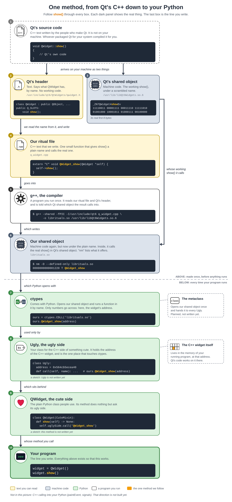

# One method, from Qt's C++ down to your Python

## What it shows

One method, `QWidget::show()`, followed through every stage from Qt's
own source code down to the Python line `widget.show()`. It replaces the
overview in `qt-to-python-every-piece.png` as the picture to learn from.

## How to read it

- Top to bottom, ten numbered boxes. The last box is the line you write.
- Every arrow means the same thing: the box above is what the box below
  is made from or uses. The words beside each arrow join the two boxes
  into one sentence.
- Each box has a small picture of what kind of thing it is, and a dark
  panel showing the real thing: the header's own lines, the first eight
  bytes of the compiled `show()`, the `g++` command, the `nm` output.
- `show` is orange wherever it appears, so the eye can follow it.
- The dashed line splits what is made once from what happens each run.

## What is real and what is a sketch

Boxes 1 to 7 show things that exist and were run on this machine. The
ritual file in box 4 and the command in box 5 were compiled, and box 6
shows the real `nm` line. Boxes 8 and 9 are marked as sketches: `Ugly`
and the `show` method of the cute `QWidget` are not written yet. The
metaclass beside box 7 is planned.

## Not in the picture

C++ calling into Python (`paintEvent`, signals). That direction is not
built yet.

## Rendering

Drawn by the script beside it and rendered on this machine, with no web
service:

    python one-method-from-qt-to-python.py one-method-from-qt-to-python.svg
    rsvg-convert -o one-method-from-qt-to-python.png one-method-from-qt-to-python.svg
