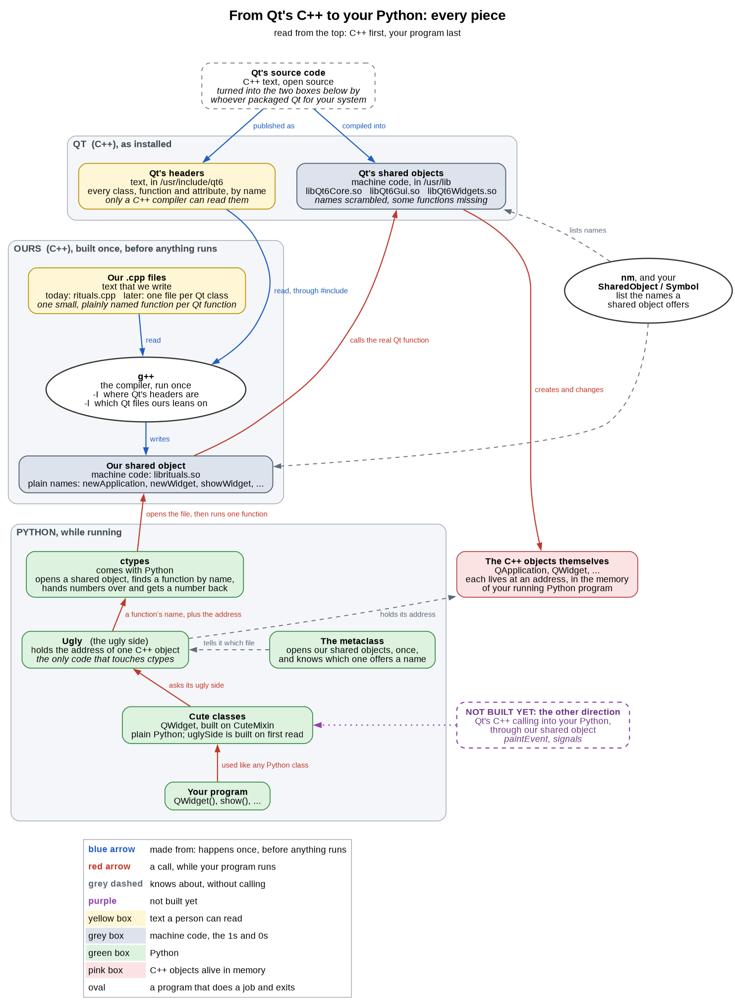

# From Qt's C++ to your Python: every piece

## What it shows

Every piece that sits between Qt's C++ and a Python program, read from
the top: Qt's source, the two things it is installed as (headers and
shared objects), our own `.cpp` files, the compiler, our shared object,
`ctypes`, the ugly side, the metaclass, the cute classes and the program
using them. The C++ objects living in memory and the tools that list a
shared object's names are shown beside the main column.

## How to read it

- Blue arrows: made from. This happens once, before anything runs.
- Red arrows: a call while the program runs. Each points from the caller
  to the thing it calls, so they run upward, from Python to C++.
- Grey dashed arrows: knows about, without calling.
- Purple: not built yet, the direction where C++ calls into Python.
- Yellow boxes are text a person can read, grey boxes are machine code,
  green boxes are Python, the pink box is C++ objects alive in memory,
  and ovals are programs that do a job and exit.

## Why GraphViz

The picture mixes two kinds of relation between the same boxes, made-from
and calls, in opposite directions. GraphViz lets each kind have its own
colour and direction while the boxes stay in one top-to-bottom column
with grouped layers. A sequence diagram would show one call well but not
where the files come from.

## Rendering

Rendered on this machine with the installed `dot`, not through a web
service:

    dot -Tpng -Gdpi=100 qt-to-python-every-piece.dot -o qt-to-python-every-piece.png
    dot -Tsvg qt-to-python-every-piece.dot -o qt-to-python-every-piece.svg

## Assumptions

- The three Qt shared objects shown are the ones a widgets program needs.
- "One file per Qt class" for our `.cpp` files is the plan, not the
  current state; today there is one `rituals.cpp`.
- The metaclass box describes the single collecting metaclass that was
  discussed, which is not written yet.
